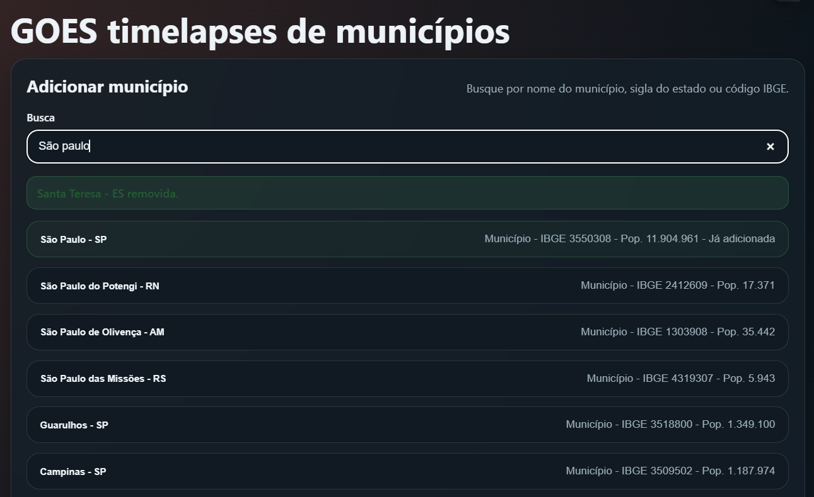
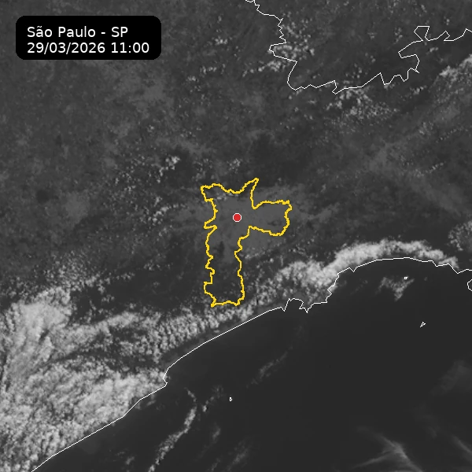
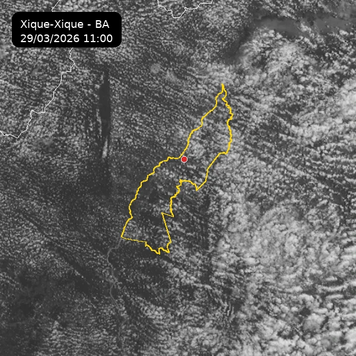

# GOES Timelapse para Home Assistant

[![Release][badge-release]][link-release]
[![Atividade][badge-commit-activity]][link-commits]
[![Testes][badge-tests]][link-tests]
[![Licença][badge-license]][link-license]

Este repositório contém um app do Home Assistant para acompanhar municípios brasileiros com imagens do satélite GOES-19. O app monta uma timeline útil de frames por município, lê dos produtos oficiais da NOAA apenas as partes necessárias, gera animações WebP dentro do Home Assistant e sobrepõe marcador opcional e descargas elétricas GLM.

> [!NOTE]
> Este projeto foi construído com ajuda intensiva de IA generativa. O código está em uso real e foi revisado ao longo do desenvolvimento, mas a expectativa correta continua sendo validação humana contínua antes de uso em produção.
<!-- -->
> [!WARNING]
> Cada município consome cerca de `0.9 GB/dia` de internet. Veja [Uso de rede](#uso-de-rede).

## O que o app faz

- Busca municípios brasileiros.
- Mantém até 5 municípios acompanhados ao mesmo tempo.
- Usa `Banda 2 (C02)` de dia, `Banda 13 (C13)` à noite e faz crossfade no amanhecer e no entardecer.
- Agrega descargas elétricas `GLM-L2-LCFA` em janelas de `10 minutos` e desenha pontos azuis sobre o frame.
- Permite um marcador opcional por município, desenhado como um ponto vermelho.
- Regera as animações quando chegam novos quadros da timeline útil.
- Publica os arquivos finais em `/media/goes_timelapse/`.

## Requisitos

- Home Assistant com Supervisor.
- Arquitetura `amd64`.

## Compatibilidade de arquitetura

Hoje este add-on está publicado apenas para `amd64`, ou seja, ele funciona em instalações Home Assistant rodando em CPU `x86_64`.

Exemplos que funcionam:

- mini PC Intel/AMD com Home Assistant OS
- NUC Intel
- desktop ou notebook x86_64 reaproveitado
- VM x86_64 em Proxmox, VMware ou VirtualBox

Exemplos que não funcionam com o pacote atual:

- Raspberry Pi 3
- Raspberry Pi 4
- Raspberry Pi 5
- Home Assistant Yellow
- Orange Pi e outras placas ARM

Para esses dispositivos ARM, seria necessário publicar builds específicas para `aarch64`/`armv7`.

## Uso de rede

Este app usa os produtos oficiais `ABI-L1b-RadF-M6C02`, `ABI-L1b-RadF-M6C13` e `GLM-L2-LCFA` da NOAA.

O app não baixa os arquivos inteiros da NOAA. Ele lê por HTTP Range só o que usa:

- `C02` e `C13`: as linhas da imagem que cobrem cada município.
- `GLM`: as coordenadas dos raios.

Medido em 24h reais para Vila Velha - ES, em `2026-10-30`:

| Fonte | Por dia |
| --- | ---: |
| Imagens (`C02` e `C13`) | `0.89 GB` |
| Raios (`GLM`) | `0.03 GB` |
| **Total com 1 município** | **`0.92 GB`** |
| Baixando os arquivos inteiros | `32.9 GB` |

- Cada município lê as próprias imagens, então cada um soma cerca de `0.9 GB/dia`. Com `5` municípios, conte com cerca de `4.5 GB/dia`.
- O `GLM` é compartilhado e não aumenta com mais municípios.
- O custo depende de quantas linhas o município ocupa na imagem, então municípios grandes consomem mais.
- Os tamanhos variam com a estação e a nebulosidade. Considere esses números como ordem de grandeza.
- Ao adicionar um município, o app lê a timeline dele de uma vez, sem tocar nos arquivos dos outros. De dia, cada quadro custa cerca de `10 MB`.
- Depois de uma parada, o app recompõe os quadros que faltam, o que gera um pico temporário.

## Como adicionar ao Home Assistant

[![Adicionar o repositório ao Home Assistant][badge-my-addon-repo]][link-my-addon-repo]

Ou manualmente:

1. No Home Assistant, abra `Configurações` > `Apps`.
2. Abra a loja de apps.
3. No menu de repositórios, adicione esta URL:

   ```text
   https://github.com/chiconws/br-goes-timelapse
   ```

4. Atualize a loja.
5. Procure por `GOES Timelapse`.
6. Clique em `Instalar`.
7. Inicie o app e abra a interface pela opção de Ingress.

Em versões mais antigas do Home Assistant, a área de `Apps` ainda pode aparecer como `Add-ons`.

## Como usar

1. Abra a interface do app.
2. Busque o município desejado.
3. Adicione o município ao acompanhamento.
4. Se quiser, configure um marcador manual com um único campo no formato `latitude, longitude`.
5. Aguarde a leitura inicial dos quadros da NOAA.
6. Quando o processamento terminar, a animação ficará disponível na interface e em `/media/goes_timelapse/`.

## Armazenamento e diretórios

Por padrão, o app usa estes caminhos:

- `data_dir: /data/goes_timelapse`
- `state_dir: /config/goes_timelapse/state`

```text
data_dir/
├── raw/
│   ├── visible/<area_id>/    # um GeoTIFF por slot de C02, por município
│   ├── infrared/<area_id>/   # um GeoTIFF por slot de C13, por município
│   └── lightning/            # um JSON por slot com os raios, compartilhado
├── processed/<area_id>/      # quadros PNG renderizados
└── geometry/                 # contornos dos municípios
```

- Cada município tem a própria pasta de imagens, e adicionar um novo não sobrescreve os arquivos dos outros.
- Remover um município apaga as pastas dele e mantém as dos demais.
- O app guarda apenas os quadros da timeline atual. Cada GeoTIFF ocupa cerca de `50 a 100 KB`.
- `state_dir` guarda o `state.db`, que deve ficar em armazenamento confiável.

Para guardar o cache em outro disco:

```yaml
data_dir: /media/SEU_DISCO/goes_timelapse
state_dir: /config/goes_timelapse/state
```

## Capturas de tela

Busca de municípios:



Prévia de animação gerada:





## Estrutura do repositório

- `repository.yaml`: metadados do repositório para o Home Assistant.
- `goes_timelapse/`: pasta do app do Home Assistant.

## Remoção

1. Em `Configurações` > `Apps` > `GOES Timelapse`, pare e desinstale o app. Isso apaga o `data_dir` padrão (`/data/goes_timelapse`).
2. Apague `/media/goes_timelapse/` (animações) e `/config/goes_timelapse/` (`state_dir`), e o `data_dir` se você o moveu para outro disco.
3. Se quiser, remova o repositório na loja de apps.

## Desenvolvimento

Veja o [CONTRIBUTING.md](CONTRIBUTING.md) para configurar o ambiente, rodar as verificações e os testes, e o [AGENTS.md](AGENTS.md) para a estrutura do código.

## Licença

MIT, veja [LICENSE](LICENSE).

[badge-release]: https://img.shields.io/github/v/release/chiconws/br-goes-timelapse
[badge-commit-activity]: https://img.shields.io/github/commit-activity/m/chiconws/br-goes-timelapse
[badge-tests]: https://github.com/chiconws/br-goes-timelapse/actions/workflows/tests.yaml/badge.svg
[badge-license]: https://img.shields.io/github/license/chiconws/br-goes-timelapse
[badge-my-addon-repo]: https://my.home-assistant.io/badges/supervisor_add_addon_repository.svg

[link-release]: https://github.com/chiconws/br-goes-timelapse/releases/latest
[link-commits]: https://github.com/chiconws/br-goes-timelapse/commits/main
[link-tests]: https://github.com/chiconws/br-goes-timelapse/actions/workflows/tests.yaml
[link-license]: LICENSE
[link-my-addon-repo]: https://my.home-assistant.io/redirect/supervisor_add_addon_repository/?repository_url=https%3A%2F%2Fgithub.com%2Fchiconws%2Fbr-goes-timelapse
